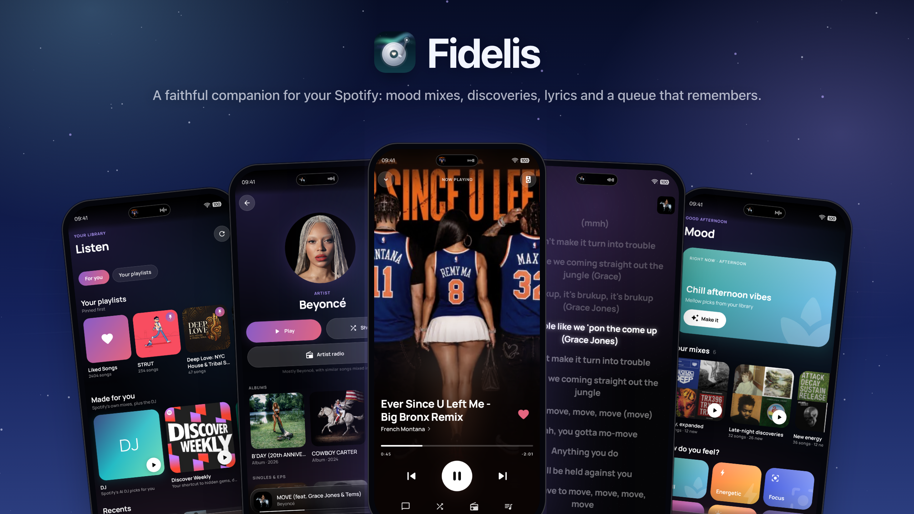
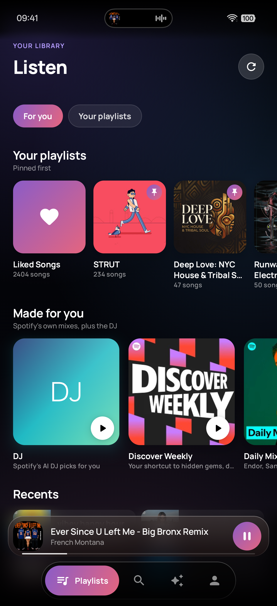
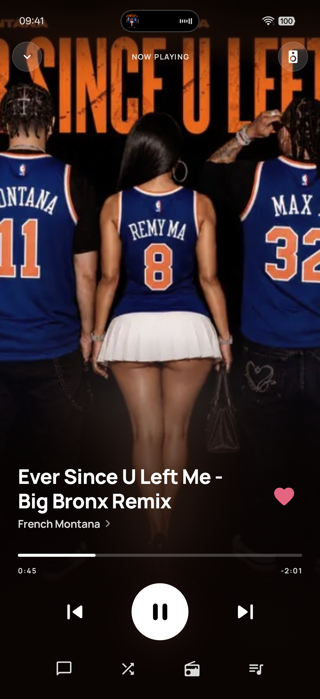
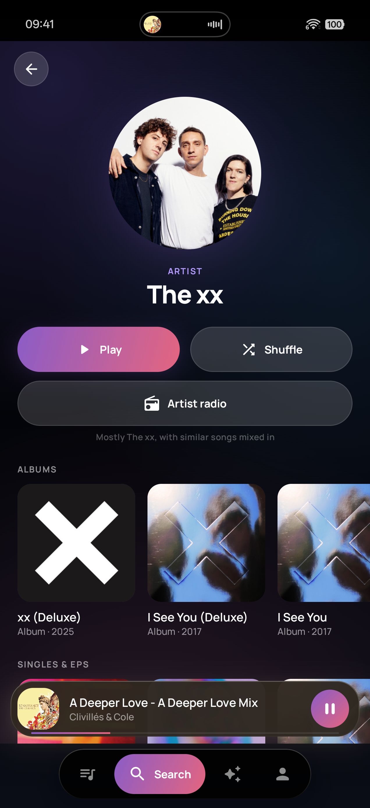
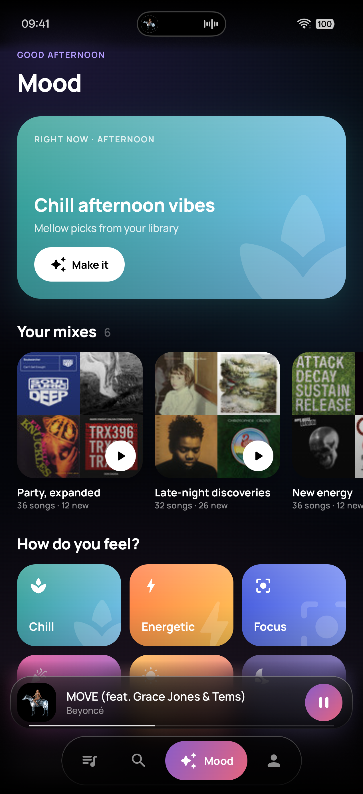

# Fidelis

**A faithful companion for your Spotify: mood mixes, discoveries, lyrics and a queue that remembers.**

Fidelis plays through the Spotify app on your phone and adds what Spotify doesn't: mixes built from how songs feel, a queue you fully control, synced lyrics and Last.fm scrobbling. No ads, no account of its own, no server.

---

☕️ You can support me and Buy me a coffee ☕️

https://buycoffee.to/szebastian

---

## What it does

- **Listen.** Your library at a glance: **Quick picks** (your most played of the last 4 weeks), **Listen again** (recently played), **Heavy rotation** (your top artists of the last 6 months), then Liked Songs and your playlists.
- **A player made for the cover.** The artwork fills the screen and glows softly under the controls in its own colour. Tap it to see the whole cover (it grows back after 5 seconds), swipe it left or right for the next or previous song, and swipe down to close.
- **Synced lyrics.** The current line glows and follows the song; tap any line to jump there. Lyrics come from LRCLIB, with plain lyrics when timed ones aren't available.
- **A queue that's yours.** Play next, add to queue, drag songs into a new order, shuffle or clear Up next. **Previous** goes back through the last 10 songs you played, instead of just restarting the current one.
- **Add to playlist.** Tap **+** next to ❤ in the player, or ⋮ › **Add to playlist** on any song: Up next, albums, artists, playlists, search and mixes. It lists the playlists you made or collaborate on.
- **Share, Spotify style.** A card in the cover's colour, then the apps you have (Instagram Stories, WhatsApp, Telegram, Messenger…), Copy link and More. Stories get a ready-made story image; chats get an open.spotify.com link.
- **Looks that live.** Every sky drifts and breathes while music plays, with a little star dust, and takes on the playing cover's colour (Profile → Follow the music). Glass cards and buttons catch the light like Consensus Weather.
- **Search everything in one bar.** Results come back as Artists, Albums and Songs.
- **Artist pages.** Albums, then Singles & EPs, then their songs ordered by popularity on Last.fm, with play counts.
- **Artist radio.** Mostly that artist, with songs in a similar vibe mixed in: two of theirs, then one similar.
- **Album pages.** Every song in the album's own order, disc by disc. Play it as it is, or shuffle.
- **Mood mixes.** Chill, Energetic, Focus, Party, Happy or Melancholy, built from your own songs using Last.fm tags, ordered so each song flows into the next. Mixes are saved as tiles you can come back to.
- **Discoveries.** Mixes that blend your favourites with new songs like them (about two of yours for every new one), each marked **NEW**.
- **Scrobbling to Last.fm.** Everything you play through Fidelis is scrobbled, following Last.fm's rules.
- **Lock screen and Fluid Cloud.** Play, pause, skip and ❤ from the lock screen, the notification shade and the Fluid Cloud capsule on Oppo phones. ❤ saves the song to your Spotify Liked Songs.
- **Five looks.** Night, Dawn, Aurora, Ocean and Midnight (pure black, for OLED screens).

## Screens

  
  
  
  
  

## Getting started

You need the **Spotify app**, installed and signed in on the same phone. Premium works best: on Spotify Free, Spotify may shuffle instead of playing the exact song you picked.

1. Open **[Releases](../../releases)** on your phone and download **fidelis-debug.apk** from **Latest debug build**.
2. Open the file. If Android asks, allow your browser to **install unknown apps**.
3. Open Fidelis and allow **notifications**, so the lock-screen controls and Fluid Cloud work.
4. In **Profile**, connect your **Spotify account** (playlists, search and library), then **Playback** (the link to the Spotify app). Sign in to **Last.fm** for scrobbling, mood tags and popularity.
5. **On Oppo / ColorOS:** Profile → **Open app settings**, then turn on **Allow auto launch** and **Allow background activity**, and set **Battery** to **Don't optimise**. Otherwise ColorOS can freeze Fidelis while the screen is off and Up next stops after the current song.

Updating: install the new APK over the old one. Your sign-ins and mixes stay.

## What it can't do

Spotify limits what apps like Fidelis can see. Fidelis can only list the songs of playlists you created or collaborate on (others still play in full through Spotify), search returns at most 10 results per type at a time, and artist songs are ranked by Last.fm because Spotify no longer shares its own top songs.

## Privacy

There's no Fidelis server and no analytics. Your Spotify and Last.fm sign-ins are stored encrypted on your phone. Fidelis talks only to Spotify (your library and playback), Last.fm (song and artist names, for tags, similar songs, popularity and scrobbles) and LRCLIB (the title and artist of the song you open lyrics for). Saved mixes and the tag cache stay on your phone.

---

_Fidelis is Latin for faithful. Its root, fidēs, was also the Roman word for the strings of a lyre. It's a sibling to Consensus Weather, Kalendae, Vestis, Caelum, Hora and Augur._

For developers

A native Android app in Kotlin and Jetpack Compose (Material 3, Hilt, coroutines, Coil, OkHttp). It plays through the Spotify app with the Spotify App Remote SDK and reads your library through the Spotify Web API (PKCE sign-in). GitHub Actions builds a debug APK on every push to `main` and publishes it to the **latest-debug** release.

| Where | What it is |
| --- | --- |
| `integration/spotify/` | `SpotifyRepository` (Web API, sign-in, token refresh), `SpotifyRemote` (App Remote bridge, plus Fidelis's own Up next and 10-song history), `SpotifyCatalog` (search, artists, albums), `ArtistRadio`, `HomeFeed` |
| `integration/lastfm/` | Tags, similar songs and top tracks (`LastfmApiImpl`, `LastfmTop`), sign-in, and scrobbling (`BridgeScrobbler`) |
| `integration/lyrics/` | `LrcLib`: synced and plain lyrics |
| `mood/` | `MoodRepository` (mood scoring, flow ordering, discoveries), `TagCache`, `MixStore`, and the Mood screens |
| `playback/` | `PlaybackService`: media session and notification for the lock screen and Fluid Cloud |
| `ui/` | Screens; `ui/theme/` holds the looks, the Manrope type and shared components |
| `tools/install.sh` | Waits for the build of your last push and installs it on the plugged-in phone |
| `tools/screenshots.sh`, `tools/banner.html` | Make everything in `screenshots/` from the phone |
| `.github/workflows/android.yml` | Builds the APK and publishes it to the latest-debug release |

**Keys.** Put `SPOTIFY_CLIENT_ID`, `LASTFM_API_KEY` and `LASTFM_SECRET` in `local.properties` (git-ignored) for local builds, and as repository secrets for GitHub Actions. Never commit them.

**Spotify setup.** In the Spotify developer dashboard, add the redirect URI `fidelis://auth` and the Android package `com.fidelis.player` with the SHA-1 of your own signing key (kept outside the repo; GitHub builds read it from the `FIDELIS_KEYSTORE_B64` and `FIDELIS_KEYSTORE_PASSWORD` secrets). In Development Mode, only accounts added under User Management can sign in.

**Build and install:** push to `main`, then run `tools/install.sh`. **Screenshots:** `tools/screenshots.sh`, or `tools/screenshots.sh --banner-only` to rebuild just the banner.

